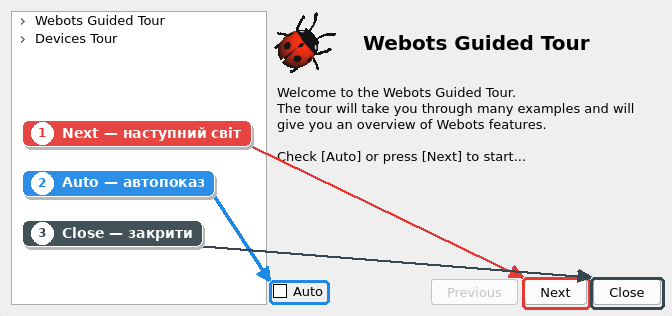
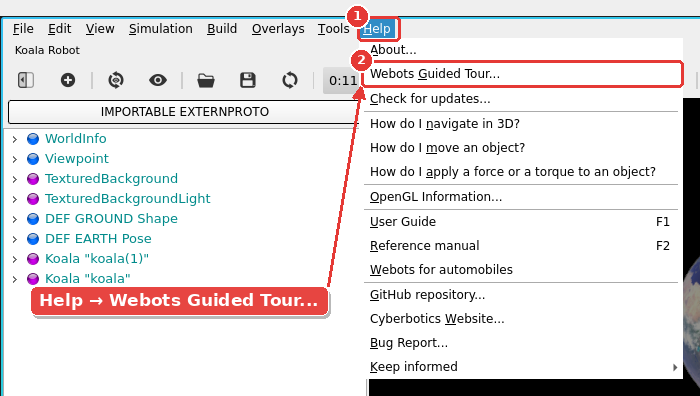
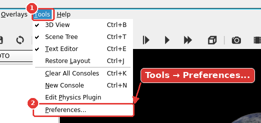
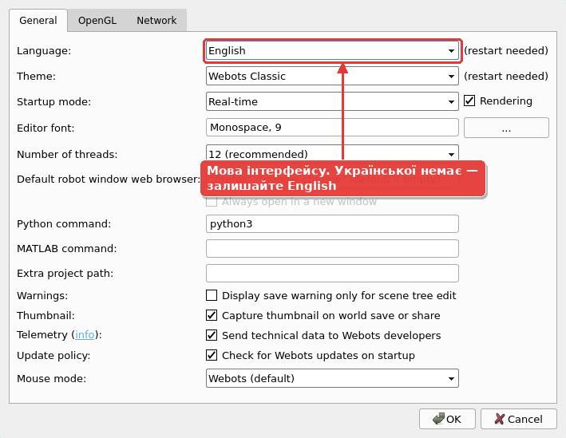
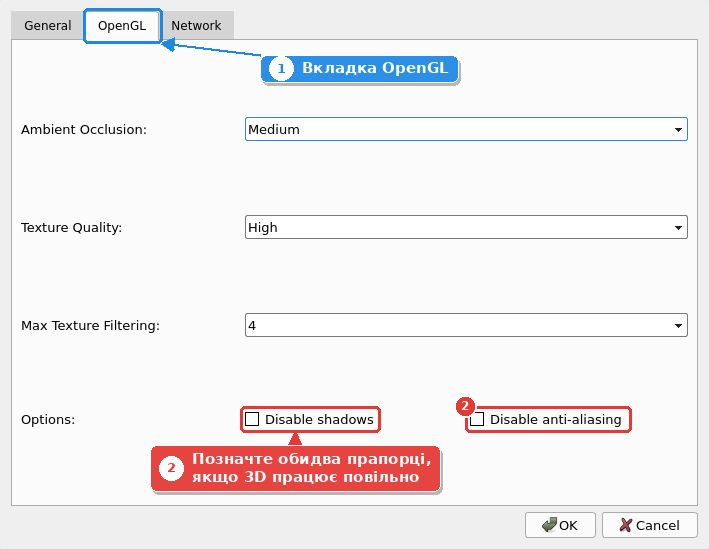

# 3. Webots: де взяти і як встановити

## Що таке Webots

**Webots** — безкоштовний симулятор роботів з відкритим кодом.

* Розробляється з 1996 року. Створений у Федеральній політехнічній школі Лозанни (EPFL, Швейцарія), підтримується компанією **Cyberbotics**.
* З 2018 року має відкритий код (ліцензія Apache 2.0): його можна вільно використовувати в навчанні й у комерційних проєктах.
* Містить бібліотеку готових моделей: навчальний робот e-puck, крокуючий Spot, промислові маніпулятори Universal Robots, дрон DJI Mavic, автомобілі та багато іншого.
* Програми для роботів (контролери) можна писати мовами C, C++, Python, Java, MATLAB.
* Працює разом з **ROS 2**, стандартом робототехніки в промисловості та науці.

## Де взяти

| Що | Посилання |
| --- | --- |
| Офіційний сайт | [cyberbotics.com](https://cyberbotics.com) |
| Усі версії для завантаження | [github.com/cyberbotics/webots/releases](https://github.com/cyberbotics/webots/releases) |
| Документація (англійською) | [cyberbotics.com/doc/guide](https://cyberbotics.com/doc/guide/index) |

Актуальна стабільна версія: **R2025a**. Файли для завантаження:

| ОС | Файл |
| --- | --- |
| Linux (Ubuntu) | `webots_2025a_amd64.deb` |
| Linux (будь-який дистрибутив) | `webots-R2025a-x86-64.tar.bz2` |
| Windows 10/11 | `webots-R2025a_setup.exe` |
| macOS | `webots-R2025a.dmg` |

!!! warning "Увага"

    Завантажуйте **стабільні** версії з назвою на кшталт `R2025a`. Збірки «nightly» призначені для розробників і можуть працювати нестабільно.

## Системні вимоги

* **Процесор**: від 2 ГГц, 2 ядра (рекомендовано 4 ядра).
* **Оперативна пам'ять**: від 2 ГБ.
* **Відеокарта**: з підтримкою OpenGL 3.3 або новішої, від 512 МБ відеопам'яті. Для Linux розробники рекомендують NVIDIA. Вбудована графіка Intel іноді працює повільно або з помилками.
* **ОС**: Ubuntu 22.04 / 24.04 LTS та інші сучасні 64-бітні дистрибутиви Linux, Windows 10/11 (64-біт), macOS.

### Перевірте свій комп'ютер (Linux)

Версія Ubuntu (Webots не працює на Ubuntu, старішій за 22.04):

```bash
lsb_release -a
```

Відеокарта і версія OpenGL (потрібна 3.3 або новіша):

```bash
sudo apt install mesa-utils
glxinfo -B | grep -E "OpenGL (vendor|renderer|version)"
```

## Встановлення в Linux (Ubuntu)

Для встановлення потрібні права адміністратора (`sudo`). Після встановлення Webots може запускати будь-який користувач.

### Спосіб 1. Через репозиторій APT (рекомендовано)

Перевага: Webots оновлюватиметься разом із системою.

```bash
# 1. Додати ключ для перевірки пакетів Cyberbotics
sudo mkdir -p /etc/apt/keyrings
cd /etc/apt/keyrings
sudo wget -q https://cyberbotics.com/Cyberbotics.asc

# 2. Додати репозиторій Cyberbotics
echo "deb [arch=amd64 signed-by=/etc/apt/keyrings/Cyberbotics.asc] https://cyberbotics.com/debian binary-amd64/" | sudo tee /etc/apt/sources.list.d/Cyberbotics.list
sudo apt update

# 3. Встановити Webots
sudo apt install webots
```

### Спосіб 2. З файлу .deb

Завантажте `webots_2025a_amd64.deb` зі сторінки релізів і виконайте в папці з файлом:

```bash
sudo apt install ./webots_2025a_amd64.deb
```

Або просто двічі клацніть на файлі, і він відкриється в центрі застосунків Ubuntu.

### Спосіб 3. Через Snap

```bash
sudo snap install webots
```

Найпростіший спосіб, але завантаження значно більше: близько 600 МБ проти ~150 МБ для `.deb`.

### Спосіб 4. Архів без прав адміністратора

Підходить, якщо у вас немає прав `sudo` (наприклад, на чужому чи робочому комп'ютері):

```bash
tar xjf webots-R2025a-x86-64.tar.bz2
export WEBOTS_HOME=$HOME/webots
$WEBOTS_HOME/webots
```

## Перший запуск

Запустіть Webots з меню програм або командою в терміналі:

```bash
webots
```

Під час першого запуску:

1. Webots запропонує вибрати **тему оформлення** (світлу чи темну).
2. Відкриється **Webots Guided Tour**, екскурсія демонстраційними світами. Перегляньте кілька світів, наприклад з роботом Spot чи автомобілем, щоб побачити, на що здатний Webots.



Кнопка **Next** відкриває наступний світ, прапорець **Auto** вмикає автоматичний показ, **Close** закриває екскурсію. Відкрити її знову можна через меню **Help → Webots Guided Tour...**



!!! warning "Увага"

    Текстури та 3D-моделі об'єктів Webots завантажує з Інтернету під час першого використання і зберігає в кеші (`~/.cache/Cyberbotics/Webots`). Тому перше відкриття світу може тривати довше, а без Інтернету деякі об'єкти можуть відображатися без текстур. **Під час першого проходження курсу тримайте комп'ютер підключеним до Інтернету.**

### Мова інтерфейсу

Мову змінюють у **Tools → Preferences...**, вкладка **General**, поле **Language**. Української серед доступних мов немає, тому працюємо з англійським інтерфейсом. Переклад усіх термінів є у [словнику](08-slovnyk.md).





## Якщо щось пішло не так

| Проблема | Причина | Рішення |
| --- | --- | --- |
| Webots не запускається або «падає» | Драйвер відеокарти без підтримки OpenGL 3.3 | Оновіть драйвер; для NVIDIA встановіть пропрієтарний драйвер (**Програми та оновлення → Додаткові драйвери**) |
| Дуже низька швидкість 3D | Слабка відеокарта | **Tools → Preferences → OpenGL**: позначте **Disable shadows** і **Disable anti-aliasing** |
| Сірі об'єкти без текстур | Немає Інтернету, кеш порожній | Підключіться до Інтернету й перезавантажте світ |
| `glxinfo: command not found` | Не встановлено пакет | `sudo apt install mesa-utils` |

Де саме вимикати тіні та згладжування, якщо 3D працює повільно: **Tools → Preferences...**, вкладка **OpenGL**. Після цього натисніть **OK**.


