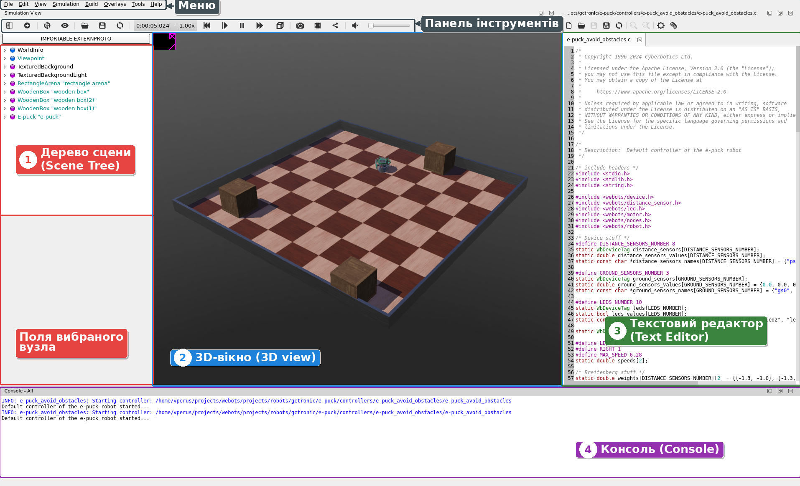
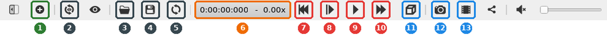
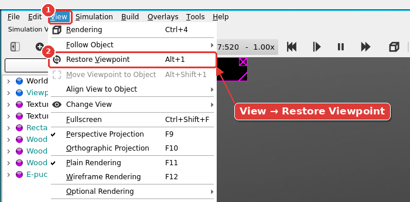
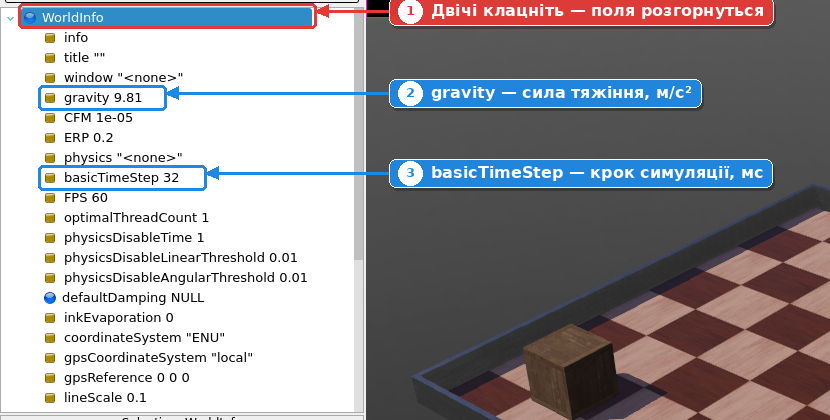

# 4. Інтерфейс Webots

Запустіть Webots і тримайте його відкритим: усе, що описано в цьому розділі, пробуйте одразу.

## Головне вікно

Головне вікно Webots складається з чотирьох основних частин. Над ними розташовані меню і панель інструментів.

| № | Частина | Англійською | Для чого |
| --- | --- | --- | --- |
| 1 | **Дерево сцени** | Scene Tree | Список усіх об'єктів світу у вигляді дерева. Під ним показано поля вибраного вузла: тут змінюють властивості об'єктів |
| 2 | **3D-вікно** | 3D view | Показує світ і роботів. Тут можна обертати камеру, вибирати й переміщувати об'єкти |
| 3 | **Текстовий редактор** | Text Editor | Редагування програм (контролерів) роботів |
| 4 | **Консоль** | Console | Повідомлення Webots і програм роботів, помилки |

## Меню

| Меню | Що в ньому |
| --- | --- |
| **File** | Створення проєкту і світу, відкриття, збереження, знімок екрана, запис відео |
| **Edit** | Копіювання, вставлення, скасування дій |
| **View** | Керування камерою 3D-вікна, режими відображення |
| **Simulation** | Запуск, пауза, крок симуляції |
| **Build** | Компіляція програм роботів |
| **Overlays** | Вікна камер і дисплеїв роботів поверх 3D-вікна |
| **Tools** | Налаштування (Preferences), додаткові вікна |
| **Help** | Документація, Guided Tour, перевірка оновлень |

## Панель інструментів

| № | Кнопка | Що робить | Клавіші |
| --- | --- | --- | --- |
| 1 | **Add** | Додає новий об'єкт (вузол) у світ | Ctrl+Shift+A |
| 2 | **Restore Viewpoint** | Повертає камеру до початкового виду | |
| 3 | **Open World** | Відкриває файл світу | Ctrl+Shift+O |
| 4 | **Save World** | Зберігає світ у файл | Ctrl+Shift+S |
| 5 | **Reload World** | Перезавантажує світ із збереженого файлу | Ctrl+Shift+R |
| 6 | Лічильник часу | Віртуальний час і множник швидкості | |
| 7 | **Reset Simulation** | Повертає світ до початкового стану | Ctrl+Shift+T |
| 8 | **Step** | Виконує один крок симуляції | Ctrl+1 |
| 9 | **Real-time / Pause** | Запускає симуляцію в реальному часі. Під час симуляції ця сама кнопка стає **Pause** і зупиняє її | Ctrl+2 / Ctrl+0 |
| 10 | **Fast** | Запускає симуляцію якнайшвидше | Ctrl+3 |
| 11 | **Rendering** | Вимикає показ 3D, щоб симуляція йшла швидше | Ctrl+4 |
| 12 | **Take Screenshot** | Зберігає знімок 3D-вікна | Ctrl+Shift+P |
| 13 | **Make Movie** | Записує відео симуляції | |

!!! info "Примітка"

    Наведіть мишу на будь-яку кнопку: у рядку стану внизу вікна з'явиться її опис і клавіші.

Поруч із кнопками є **лічильник віртуального часу** (`0:00:12:340`): скільки часу «минуло» всередині симуляції. Поряд показано, у скільки разів симуляція швидша чи повільніша за реальний час (наприклад, `1.00x`).

!!! danger "Важливо"

    **Головне правило редагування світу:** **Pause → Reset → змінити → Save**.

    Змінюйте і зберігайте світ лише тоді, коли симуляцію зупинено, а лічильник часу показує `0:00:00:000`. Інакше збережеться положення об'єктів у момент, коли ви натиснули Save, а не початкове.

## Навігація в 3D-вікні

| Дія | Як зробити |
| --- | --- |
| Обертати камеру | Затиснути **ліву** кнопку миші й рухати |
| Переміщати камеру | Затиснути **праву** кнопку миші й рухати |
| Наближати / віддаляти | **Коліщатко** миші |
| Повернутися до початкового виду | **View → Restore Viewpoint** (Alt+1) або кнопка 2 на панелі інструментів |

## Переміщення об'єктів

| Дія | Як зробити |
| --- | --- |
| Вибрати об'єкт | Клацнути на ньому лівою кнопкою |
| Пересунути по підлозі | **Shift** + ліва кнопка + рух миші |
| Повернути навколо вертикальної осі | **Shift** + права кнопка + рух миші |
| Підняти / опустити | **Shift** + коліщатко миші |
| Точне переміщення | Потягнути за кольорові **стрілки** на вибраному об'єкті |
| Копіювати / вставити | **Ctrl+C**, **Ctrl+V** |
| Штовхнути об'єкт під час симуляції (Linux) | **Ctrl+Alt** + ліва кнопка + рух миші |

## Основні поняття

* **Світ** (World): файл з розширенням `.wbt`, який описує все в симуляції: об'єкти, їх розташування, фізику, освітлення. Зберігається в папці `worlds` проєкту.
* **Вузол** (Node): будь-який об'єкт у дереві сцени: підлога, коробка, робот, світло. Вузли можуть містити інші вузли.
* **Поле** (Field): властивість вузла, наприклад розмір (`size`), положення (`translation`), поворот (`rotation`). Поля, змінені відносно стандартних значень, виділяються іншим кольором.
* **PROTO**: готовий шаблон об'єкта (коробка, арена, робот), який можна додати у світ одним кліком.

## Спробуйте

1. Покрутіть камеру лівою кнопкою миші, пересуньте правою, наблизьте коліщатком.
2. «Загубіться» в 3D-вікні, а потім поверніться через **View → Restore Viewpoint**.
3. Знайдіть у дереві сцени вузол `WorldInfo`. Двічі клацніть на ньому й подивіться, які в нього поля.

## Перевірте себе

**1. Яке розширення має файл світу Webots і в якій папці проєкту він зберігається?**

??? success "Відповідь"

    Файл світу має розширення **`.wbt`** і зберігається в папці **`worlds`** проєкту.

**2. Що таке Scene Tree, вузол і поле?**

??? success "Відповідь"

    **Scene Tree** (дерево сцени) — ієрархічний список усіх об'єктів світу. **Вузол** (node) — окремий об'єкт у цьому дереві (арена, коробка, робот). **Поле** (field) — властивість вузла (розмір, положення, поворот тощо).

**3. Чому перед зміною і збереженням світу потрібно натиснути Pause і Reset?**

??? success "Відповідь"

    Якщо зберегти світ під час симуляції, у файл запишеться поточне положення об'єктів, а не початкове. Після кожного такого збереження положення об'єктів може «зсуватися». Тому правило: **Pause → Reset → змінити → Save**.
