# 5. Перший світ і перший робот

**Мета:** створити власний проєкт, побудувати арену з перешкодами, додати робота **e-puck** і запустити його.

**Орієнтовний час:** 15 хвилин.

Результат має виглядати приблизно так: квадратна арена, кілька дерев'яних коробок і маленький робот, який їздить і об'їжджає перешкоди.

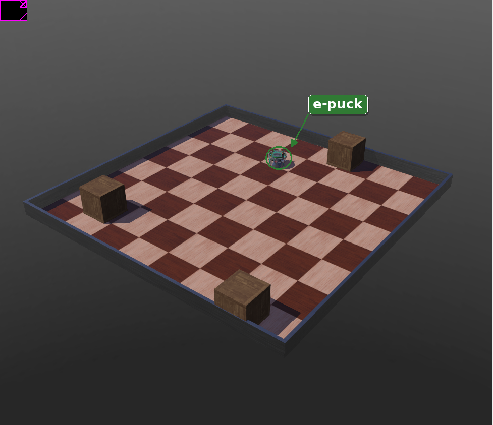

## Крок 0. Підготовка

1. Запустіть Webots.
2. Якщо відкрилася екскурсія **Guided Tour**, закрийте її.
3. Якщо симуляція виконується (лічильник часу на панелі інструментів змінюється), натисніть **Pause**, щоб її зупинити.

## Крок 1. Створюємо проєкт

1. Відкрийте меню **File → New → New Project Directory...**

    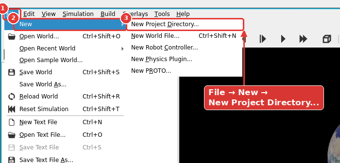
2. Відкриється майстер створення проєкту. На першій сторінці натисніть **Next**.
3. Майстер запропонує розташування й назву папки проєкту (за замовчуванням `~/Documents/my_project`). Залиште папку у своїй домашній директорії, замініть `my_project` на **`my_first_simulation`** і натисніть **Next**.

    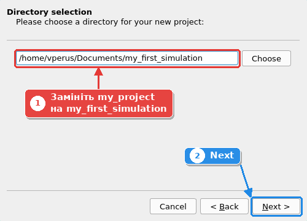
4. На сторінці **World settings** введіть у порожнє поле назву файлу світу **`my_first_simulation.wbt`**.
5. Позначте **всі** прапорці, зокрема **Add a rectangle arena** (за замовчуванням він не позначений), і натисніть **Next**.

    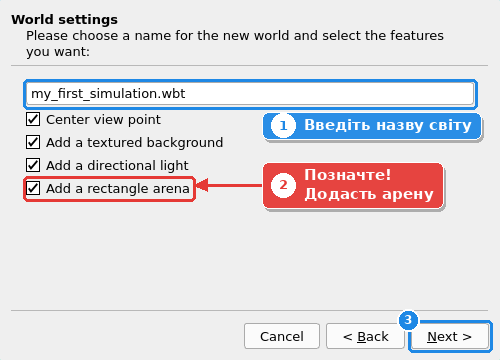
6. Майстер покаже список папок і файлів, які буде створено. Натисніть **Finish**.

    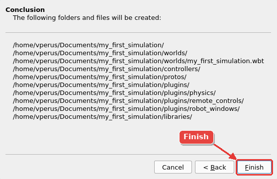

Webots створив папку проєкту зі стандартною структурою, зокрема:

```
my_first_simulation/
├── controllers/   ← програми (контролери) роботів
├── libraries/     ← бібліотеки для контролерів
├── plugins/       ← додаткові модулі
├── protos/        ← власні шаблони об'єктів
└── worlds/        ← файли світів (.wbt)
    └── my_first_simulation.wbt
```

У 3D-вікні з'явилася квадратна арена з картатою підлогою, а в дереві сцени є такі вузли:

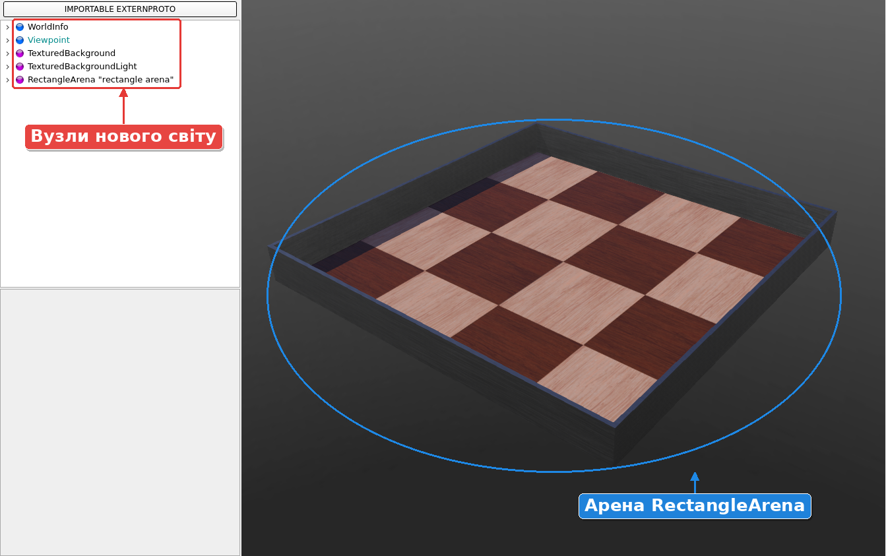

!!! info "Примітка"

    Спочатку камера дивиться на арену згори, тому вона здається маленьким квадратом. Затисніть **ліву** кнопку миші в 3D-вікні й потягніть мишу вниз або вгору, щоб подивитися на арену збоку, а **коліщатком** наблизьте її.

| Вузол | Що це |
| --- | --- |
| `WorldInfo` | Загальні параметри світу: гравітація, крок симуляції |
| `Viewpoint` | Камера, через яку ви дивитеся на світ |
| `TexturedBackground` | Фон: небо, гори на горизонті |
| `TexturedBackgroundLight` | Освітлення, що відповідає фону |
| `RectangleArena` | Арена: підлога зі стінками |

## Крок 2. Налаштовуємо арену

1. Двічі клацніть на `RectangleArena` у дереві сцени, щоб побачити його поля.
2. Виберіть поле `floorTileSize`. Під деревом сцени з'являться два поля для чисел, **x** і **y**. Введіть у кожне `0.25` і натисніть **Enter**: плитки на підлозі стануть дрібнішими.

    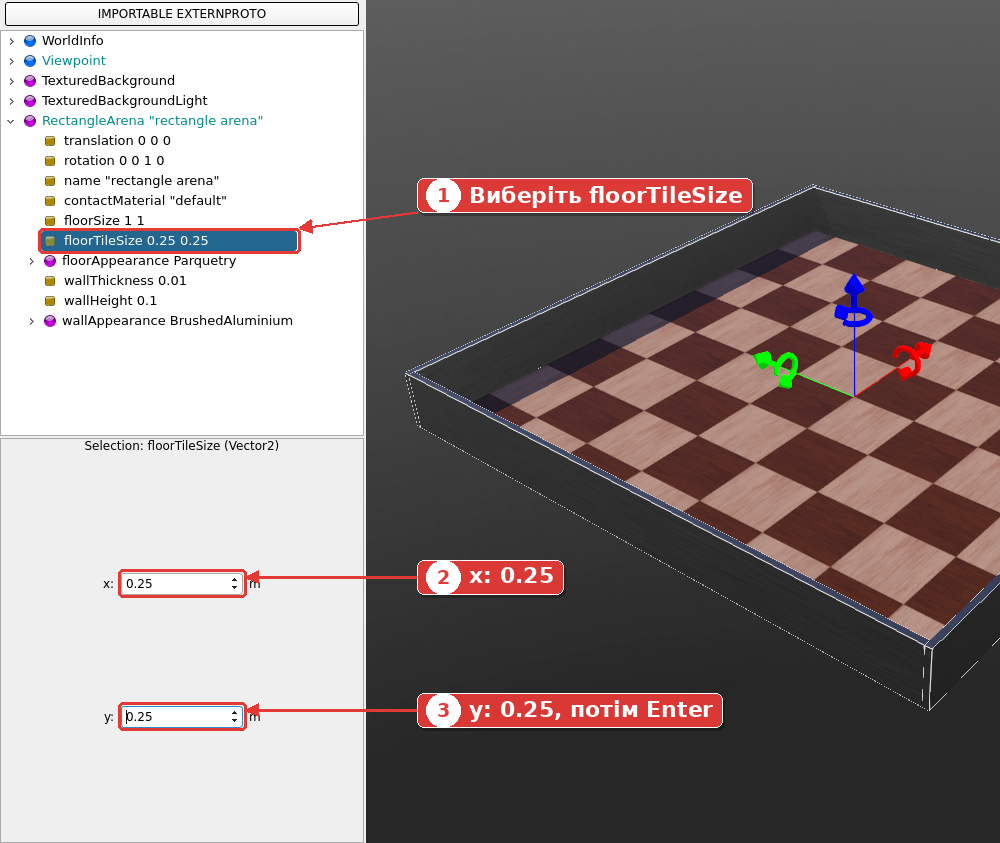
3. Виберіть поле `wallHeight`, введіть `0.05` і натисніть **Enter**: стінки стануть нижчими.

    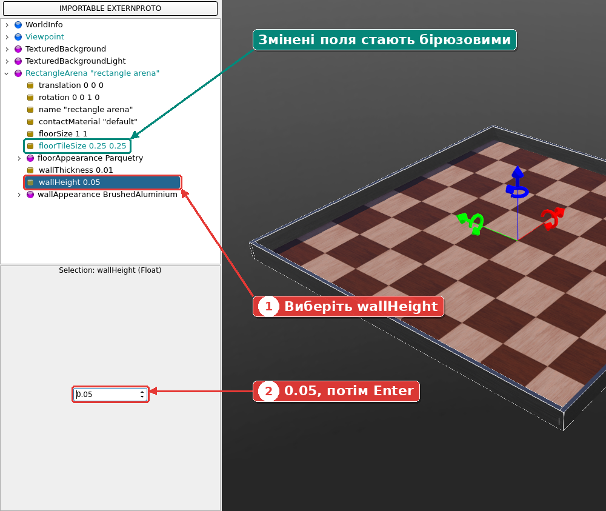

Зміни одразу видно в 3D-вікні, а змінені поля в дереві сцени стають бірюзовими.

## Крок 3. Додаємо перешкоди

1. Двічі клацніть на `RectangleArena`, щоб згорнути його, і залиште його вибраним.
2. Натисніть кнопку **Add** (кружечок із плюсом) на панелі інструментів.

    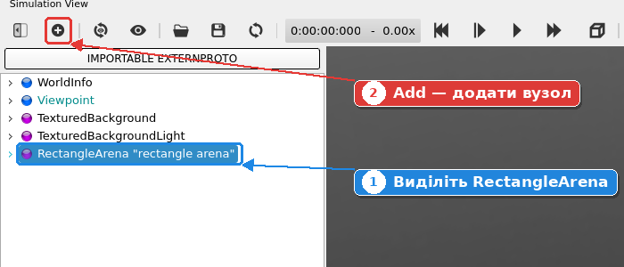
3. У вікні **Add a node** розгорніть **PROTO nodes (Webots Projects) → objects → factory → containers**, виберіть **WoodenBox (Solid)** і натисніть **Add**. Праворуч з'явиться зображення коробки: так можна перевірити, що вибрано потрібний об'єкт.

    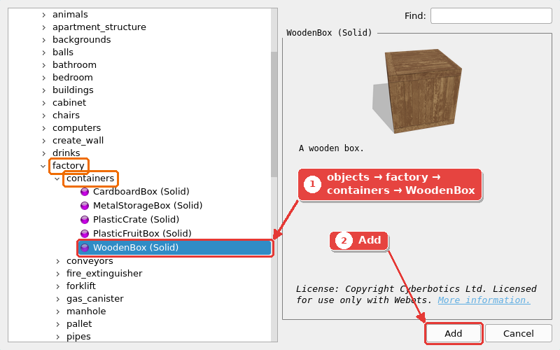

    **Порада:** щоб не шукати об'єкт у дереві, введіть його назву (наприклад, `WoodenBox`) у поле **Find** угорі вікна.
4. Посередині арени з'явилася велика коробка.

    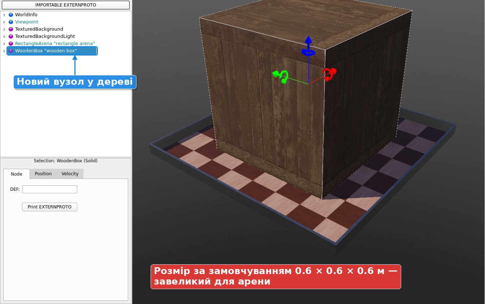
5. Розгорніть `WoodenBox` у дереві сцени (стрілка ліворуч від назви). Виберіть поле `size` і введіть у поля **x**, **y**, **z** значення `0.1`, після кожного натискаючи **Enter**. Коробка стане маленькою.

    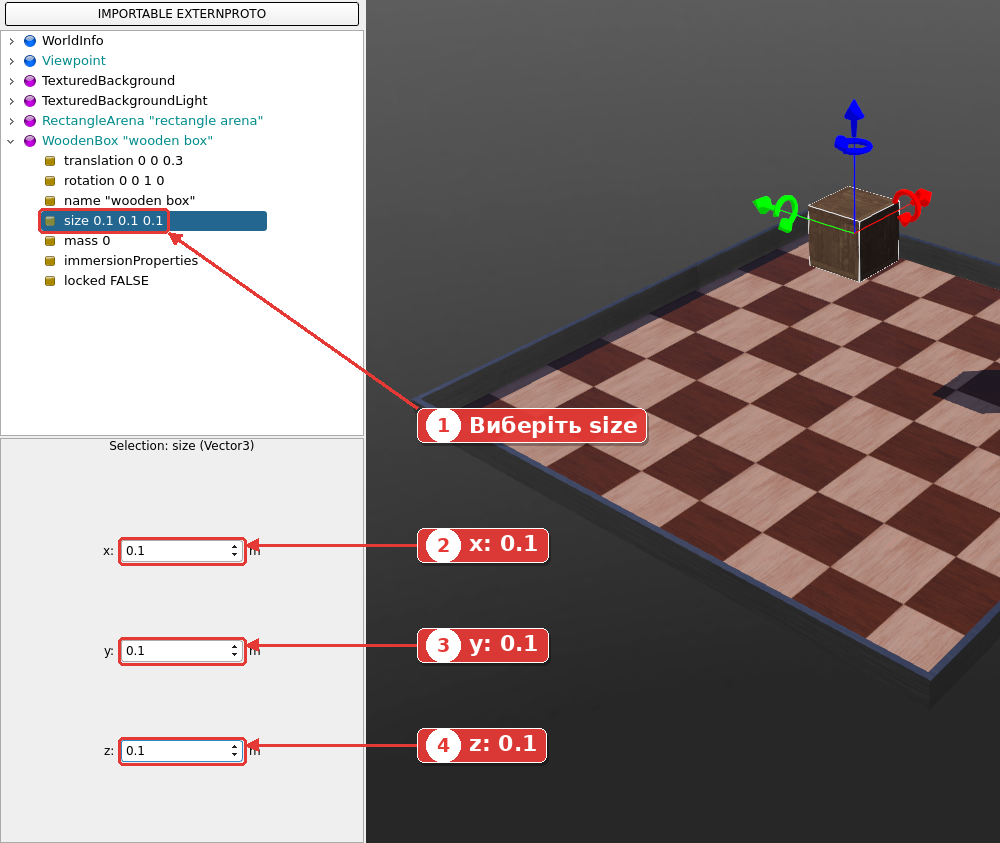
6. Тепер маленька коробка «висить» у повітрі. Виберіть поле `translation` і введіть у поле **z** значення `0.05` (половина висоти коробки): коробка стане на підлогу.

    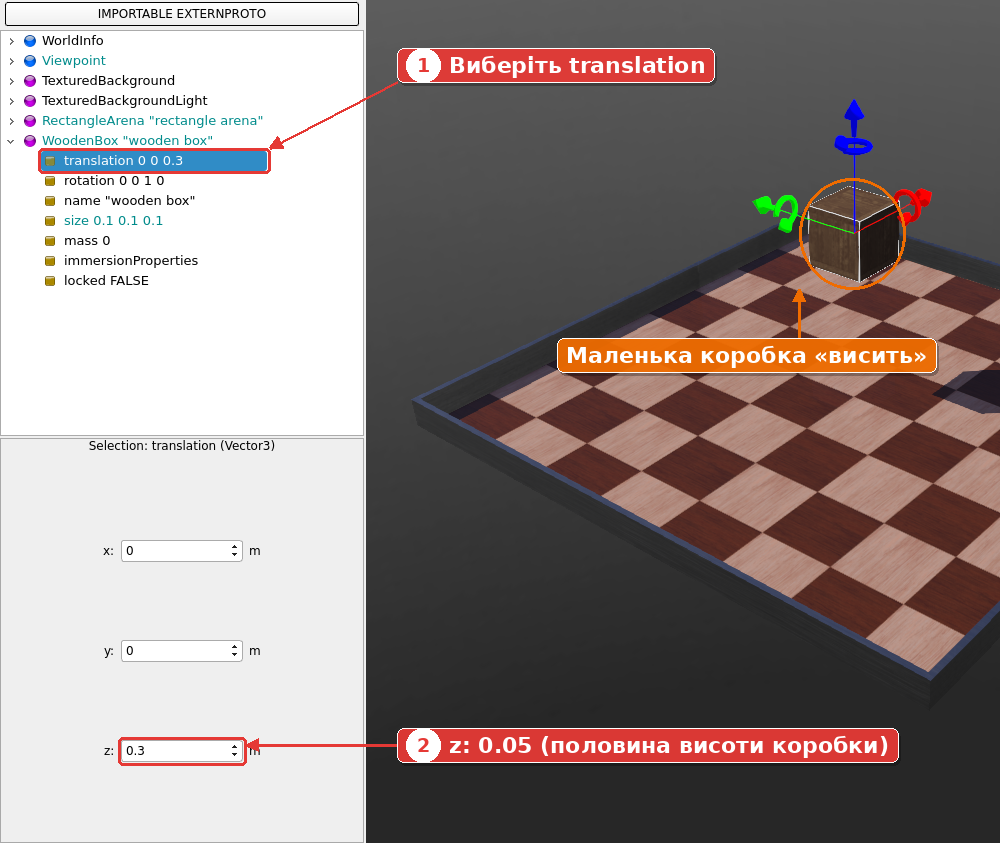
7. Затисніть **Shift** і ліву кнопку миші на коробці та перетягніть її в кут арени. Значення `translation` зміниться автоматично.

    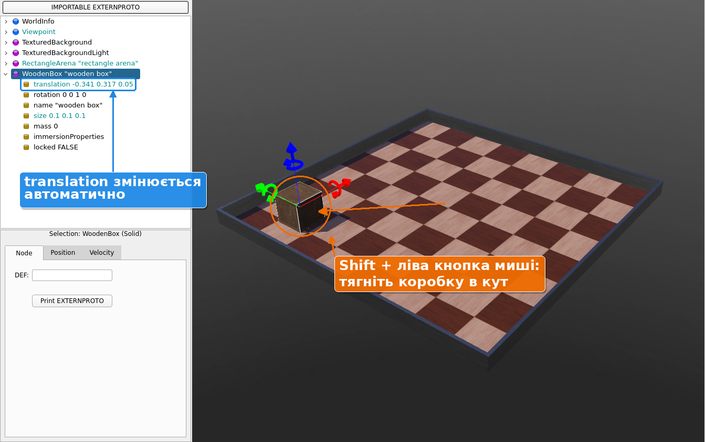
8. Не знімаючи виділення з коробки, натисніть **Ctrl+C**, потім **Ctrl+V**. Копія (`wooden box(1)`) з'явиться точно на місці оригіналу. Перетягніть її (**Shift** + ліва кнопка) в інше місце. Так само створіть третю коробку.

    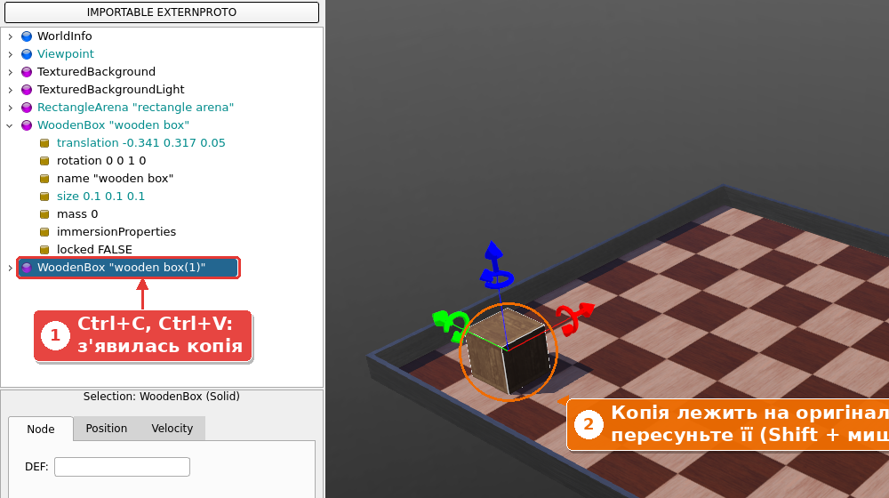
9. Переконайтеся, що в **центрі** арени немає коробок: там з'явиться робот.

    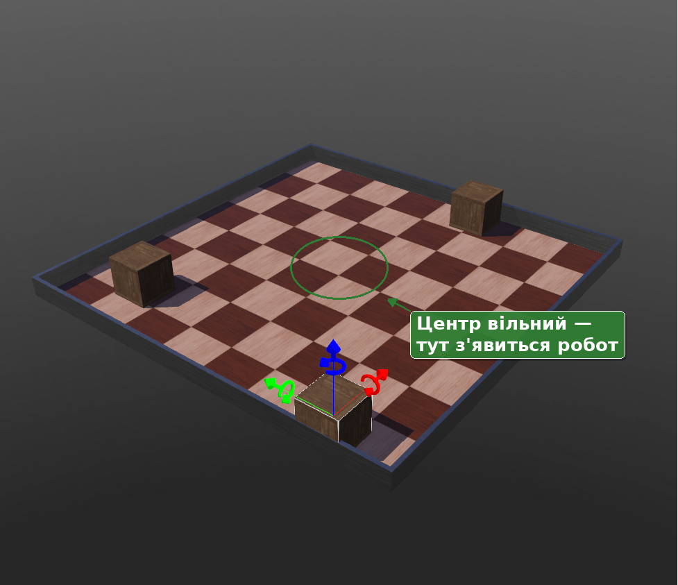
10. Збережіть світ: **Ctrl+Shift+S** або кнопка **Save World** на панелі інструментів.

    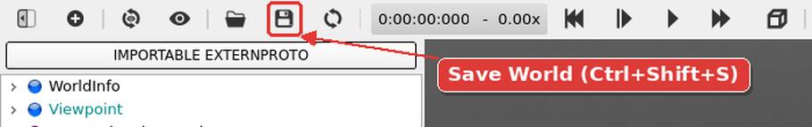

!!! warning "Увага"

    **Ctrl+S** у Webots зберігає файл у **текстовому редакторі**, а не світ. Для світу використовуйте **Ctrl+Shift+S**.

## Крок 4. Додаємо робота e-puck і запускаємо

!!! warning "Увага"

    Перед зміною світу лічильник часу має показувати `0:00:00:000`. Якщо це не так, натисніть **⏮ Reset Simulation**.

1. Виберіть в дереві сцени останню коробку `WoodenBox`.
2. Натисніть **Add** і виберіть: **PROTO nodes (Webots Projects) → robots → gctronic → e-puck → E-puck (Robot)**, потім **Add**.

    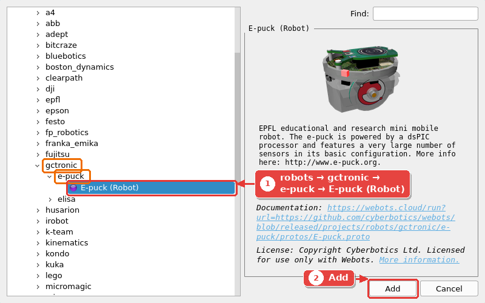
3. У центрі арени з'явився робот e-puck. За бажанням поверніть його (**Shift + права кнопка миші**).

    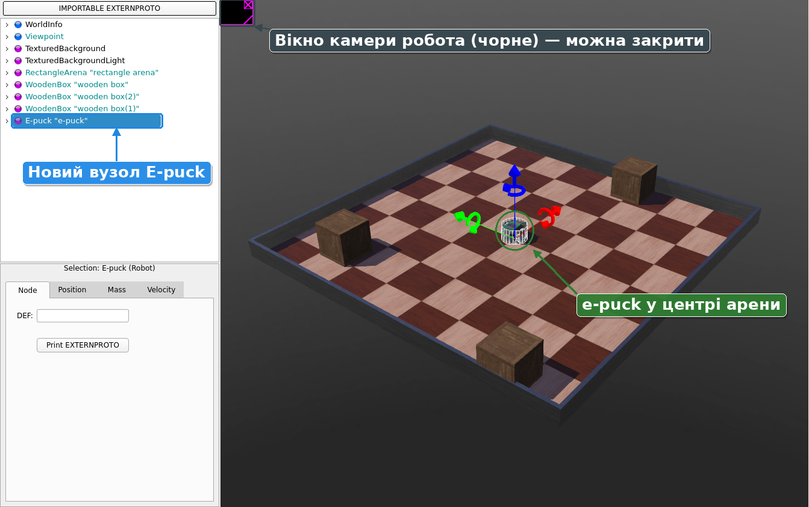
4. Збережіть світ (**Ctrl+Shift+S**).
5. Натисніть **Real-time** (трикутник ▶) на панелі інструментів.

    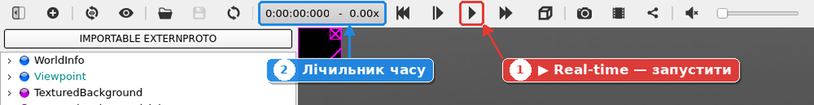

**Робот поїхав!** Він рухається, блимає світлодіодами й об'їжджає коробки. Лічильник часу почав відлік, кнопка **Real-time** перетворилася на **Pause**, а в консолі з'явилося повідомлення про запуск програми робота.

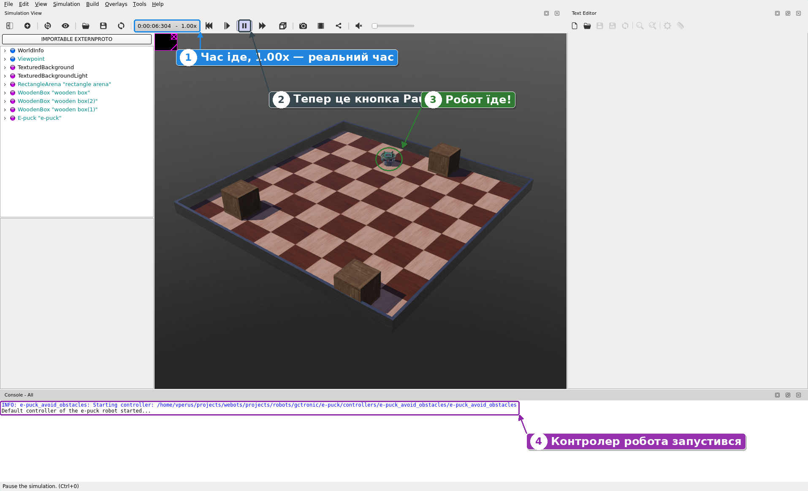

У лівому верхньому куті 3D-вікна може з'явитися маленьке чорне вікно. Це зображення з камери робота. Воно чорне, бо програма робота камеру не вмикає. Вікно можна закрити хрестиком.

### Чому робот рухається, якщо ми не писали програму?

Розгорніть вузол `E-puck` у дереві сцени й знайдіть поле `controller`. Його значення: **`e-puck_avoid_obstacles`**.

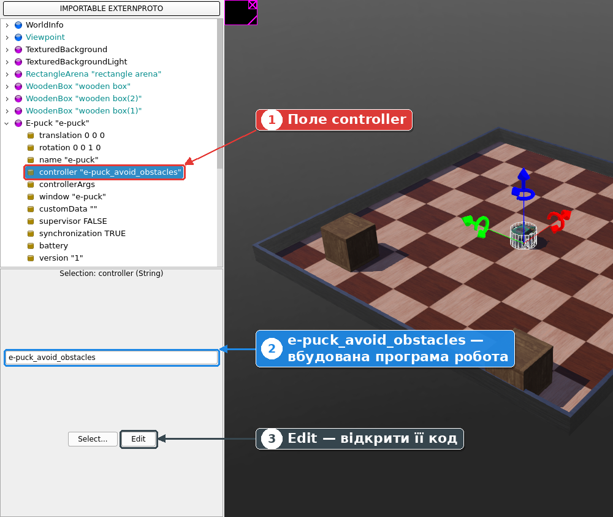

Кнопка **Edit** під значенням поля відкриває код цієї програми в текстовому редакторі. Поки що просто подивіться, але нічого не змінюйте. Це вбудована програма (контролер), яка постачається разом із моделлю робота і вміє об'їжджати перешкоди. У справжніх роботах таку програму часто називають **прошивкою** (firmware).

!!! info "Примітка"

    **Про робота e-puck.** Це справжній навчальний робот діаметром близько 7 см, створений у EPFL (Швейцарія). Має два колеса з окремими двигунами, 8 інфрачервоних датчиків відстані, камеру і 10 світлодіодів. Його використовують в університетах по всьому світу.

## Крок 5. Експериментуємо

Спробуйте виконати всі завдання:

1. **Побачте датчики.** Увімкніть **View → Optional Rendering → Show DistanceSensor Rays** (або **Ctrl+F10**). Ви побачите промені 8 датчиків відстані: так робот «бачить» перешкоди. Щоб краще роздивитися, натисніть **Pause** і наблизьте робота коліщатком миші.

    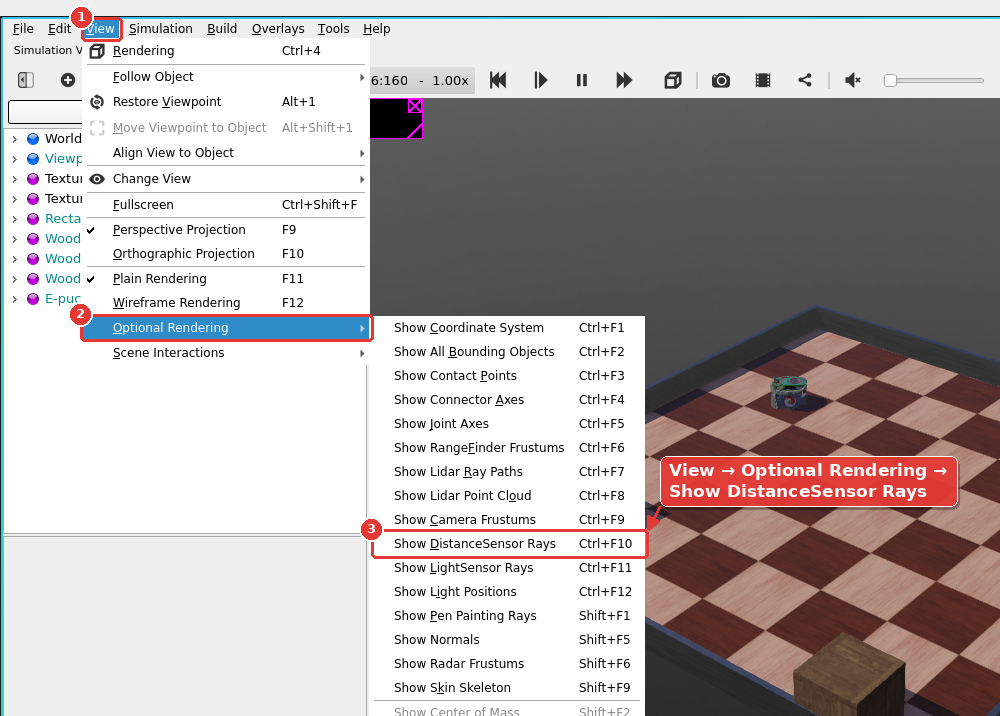

    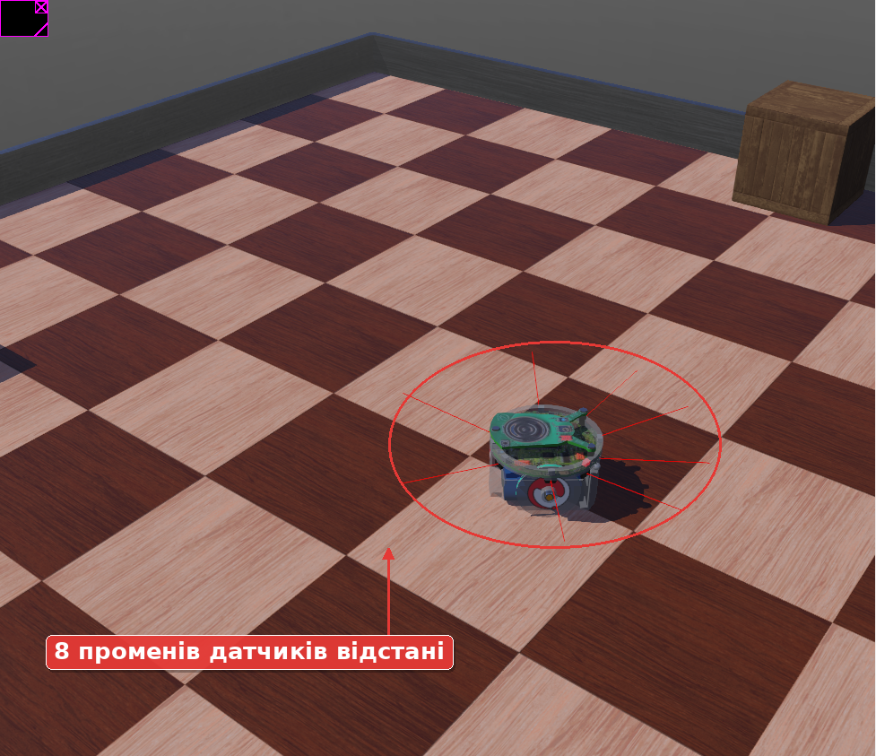
2. **Штовхніть робота.** Під час симуляції затисніть **Ctrl+Alt** і перетягніть робота лівою кнопкою миші. Як він реагує?
3. **Пришвидшіть час.** Натисніть **⏩ Fast** і подивіться на лічильник часу та множник швидкості. Порівняйте з **▶ Real-time**.
4. **Другий робот.** Натисніть **Pause** і **Reset Simulation**, скопіюйте e-puck (**Ctrl+C**, **Ctrl+V**), пересуньте копію, збережіть і запустіть. Чи об'їжджають роботи один одного?
5. **Лабіринт.** Додайте ще коробок і збудуйте простий лабіринт.

## Чек-лист

- [ ] Створено проєкт `my_first_simulation` зі світом `my_first_simulation.wbt`
- [ ] На арені є щонайменше 3 коробки
- [ ] Робот e-puck рухається й об'їжджає перешкоди
- [ ] Я знаю, де знайти поле `controller` робота
- [ ] Світ збережено

## Якщо щось пішло не так

| Проблема | Що робити |
| --- | --- |
| Робот не рухається | Перевірте, чи натиснуто **Real-time** і чи йде лічильник часу |
| Об'єкти після відкриття світу стоять «не там» | Світ було збережено під час симуляції. Розставте об'єкти знову, дотримуючись правила **Pause → Reset → змінити → Save** |
| «Загубили» арену в 3D-вікні | **View → Restore Viewpoint** (Alt+1) |
| Об'єкти без текстур (сірі) | Немає доступу до Інтернету для завантаження текстур. Підключіться до мережі й натисніть **Reload World** (Ctrl+Shift+R) |
| Майстер не може створити проєкт | Немає прав на запис у вибрану папку. Виберіть папку у своїй домашній директорії |
| Webots працює дуже повільно | **Tools → Preferences → OpenGL**: позначте **Disable shadows** і **Disable anti-aliasing** |
| Помилки в консолі | Прочитайте повідомлення: найчастіше в ньому прямо сказано, якого файлу чи об'єкта бракує. Якщо незрозуміло, пошукайте текст помилки в [документації Webots](https://cyberbotics.com/doc/guide/index) |

## Перевірте себе

**Чому робот e-puck почав рухатися, хоча ми не писали для нього програму?**

??? success "Відповідь"

    Модель робота E-puck містить вбудований контролер **`e-puck_avoid_obstacles`** (поле `controller` вузла `E-puck`). Ця програма запускається автоматично разом із симуляцією і змушує робота об'їжджати перешкоди.
