# Урок 3. Перший контролер

**Мета:** написати першу власну програму (контролер) для робота e-puck мовою Python і зрозуміти, як програма керує роботом крок за кроком.

**Час:** 35 хвилин.

## Що знадобиться

* **Webots R2025a**.
* **Проєкт з уроку 2** (`my_first_simulation`: арена, коробки й робот e-puck). Якщо його немає, завантажте стартовий проєкт [urok-03.zip](../downloads/urok-03.zip), розпакуйте його в домашню папку й відкрийте світ `urok-03/worlds/my_first_simulation.wbt` через **File → Open World...**
* **Python 3**. В Ubuntu він уже встановлений. Перевірити можна в терміналі командою `python3 --version`.

!!! info "Не знаєте Python?"

    Весь код є на сторінці, і кожен рядок пояснено в коментарях (після знака `#`). Знадобиться лише розуміти, що таке змінна, умова `if` і цикл `while`.

## Коротко: як програма керує роботом

В уроці 2 робот їздив під керуванням вбудованої програми `e-puck_avoid_obstacles`. Така програма називається **контролером**. Webots запускає контролер окремою програмою разом із симуляцією, і далі вони обмінюються даними.

Симуляція рухається **кроками**. Довжину кроку задає поле `basicTimeStep` вузла `WorldInfo`: у нашому світі це **32 мс**. За один крок Webots розраховує, як рухаються всі об'єкти світу.

Майже кожен контролер на Python має таку будову:

```python
from controller import Robot              # бібліотека Webots для Python

robot = Robot()                           # об'єкт «робот»
timestep = int(robot.getBasicTimeStep())  # крок симуляції, мс

while robot.step(timestep) != -1:         # головний цикл
    # 1. прочитати датчики
    # 2. вирішити, що робити
    # 3. дати команди двигунам
    pass
```

Головний цикл називають **циклом керування** (control loop). Це та сама схема **сприйняття → обробка → дія** з уроку 1, яка повторюється кожні 32 мс.

Головна команда тут — `robot.step(timestep)`. Вона означає: «Webots, просунь симуляцію на 32 мс і поверни керування моїй програмі». Поки контролер не викличе `step()`, симуляція чекає на нього. Коли симуляцію скидають або закривають світ, `step()` повертає `-1`, і цикл завершується.

| Команда | Що робить |
| --- | --- |
| `Robot()` | Створює об'єкт «робот», через який програма спілкується з Webots |
| `robot.getBasicTimeStep()` | Повертає крок симуляції в мілісекундах (`basicTimeStep`) |
| `robot.step(timestep)` | Просуває симуляцію на один крок; повертає `-1`, коли контролер треба зупинити |
| `robot.getTime()` | Повертає час симуляції в секундах |
| `robot.getName()` | Повертає ім'я робота (поле `name`) |
| `print(...)` | Друкує повідомлення в консоль Webots |

## Крок 1. Створюємо контролер

1. Відкрийте свій світ `my_first_simulation`. Натисніть **Pause** і **Reset Simulation** (⏮): лічильник часу має показувати `0:00:00:000`.
2. Відкрийте меню **File → New → New Robot Controller...**

    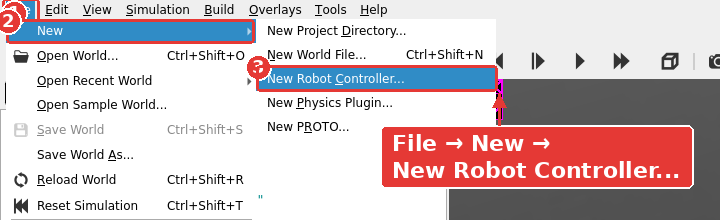

3. Відкриється майстер створення контролера. На першій сторінці натисніть **Next**.
4. На сторінці **Language selection** виберіть **Python** і натисніть **Next**.

    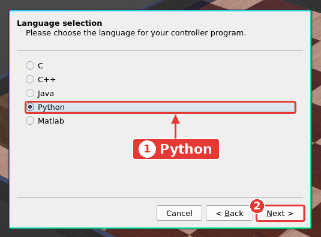

5. На сторінці **Name selection** замість `my_controller` введіть **`my_first_controller`** і натисніть **Next**.

    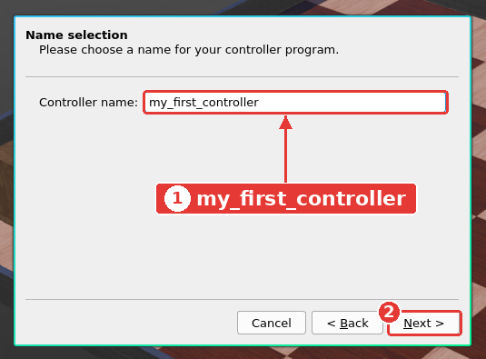

    !!! warning "Увага"

        У назві контролера використовуйте лише латинські літери, цифри й знак `_`. Без пробілів і кирилиці.

6. Сторінка **Conclusion** покаже, яку папку й файл буде створено. Залиште позначку **Open 'my_first_controller.py' in Text Editor** і натисніть **Finish**.

    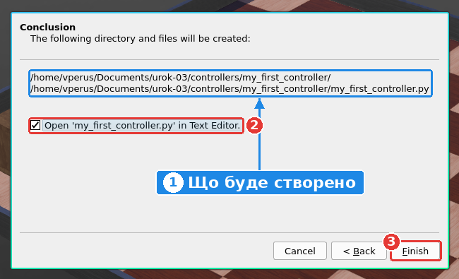

Webots створив у папці проєкту файл `controllers/my_first_controller/my_first_controller.py` і відкрив його в текстовому редакторі праворуч. Це заготовка контролера з англійськими коментарями:

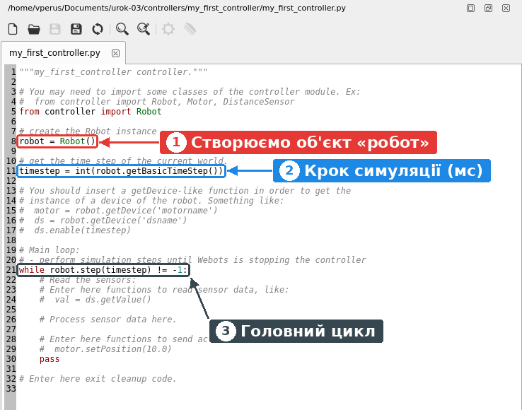

1. `robot = Robot()`: створюємо об'єкт «робот».
2. `timestep = ...`: дізнаємося крок симуляції.
3. `while robot.step(timestep) != -1:`: головний цикл. Поки що в ньому лише `pass`, тобто «нічого не робити».

## Крок 2. Призначаємо контролер роботу

Майстер лише створив файл. Робот і далі використовує стару програму `e-puck_avoid_obstacles`, тож нову програму треба призначити йому вручну.

1. Розгорніть вузол `E-puck` у дереві сцени й виберіть поле `controller`.
2. Під деревом сцени натисніть кнопку **Select...**

    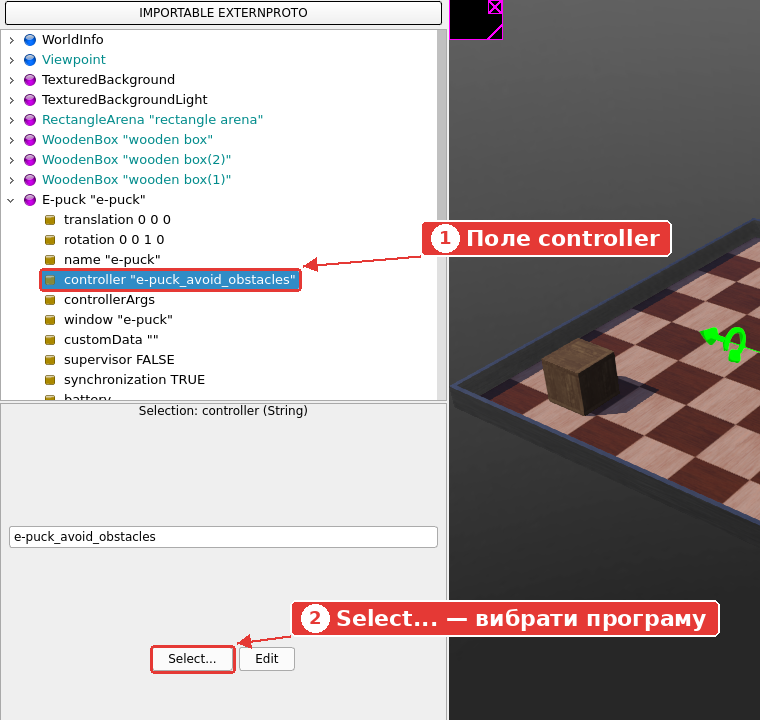

3. Відкриється список контролерів. Виберіть **`my_first_controller`** і натисніть **OK**. Порада: щоб швидко знайти потрібний рядок, наберіть на клавіатурі `my`.

    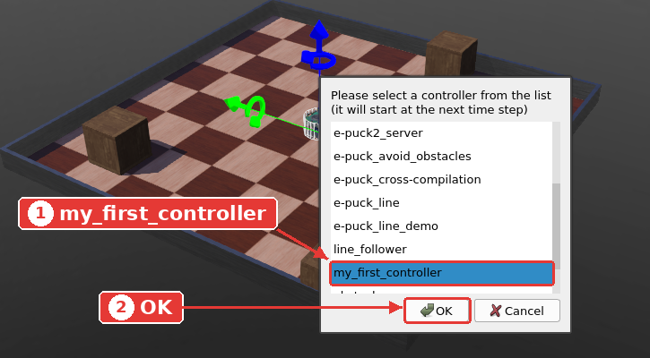

4. Збережіть світ: **Ctrl+Shift+S**.

## Крок 3. Запускаємо заготовку

Натисніть **Real-time** (▶).

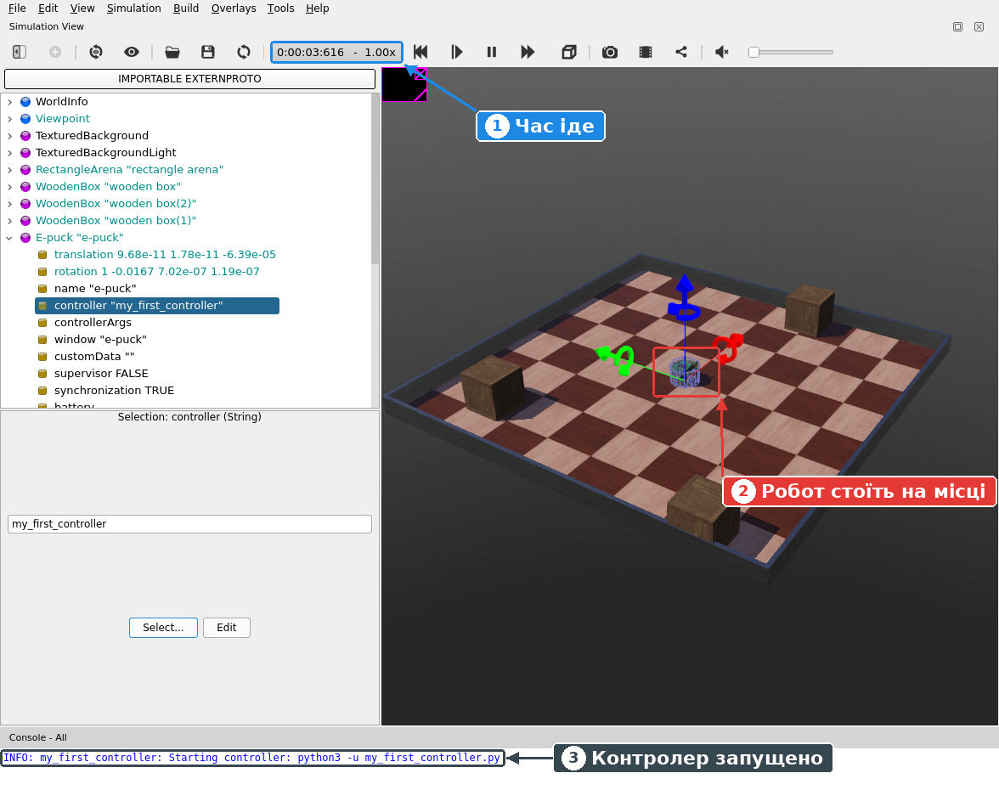

1. Лічильник часу пішов: симуляція працює.
2. Робот **стоїть на місці**: у головному циклі лише `pass`, тож програма не дає двигунам жодних команд.
3. У консолі з'явилося повідомлення `INFO: my_first_controller: Starting controller: python3 -u my_first_controller.py`: Webots запустив вашу програму.

Натисніть **Pause**, а потім **Reset Simulation**.

## Крок 4. Пишемо свою програму

1. Клацніть у текстовому редакторі, виділіть увесь текст (**Ctrl+A**) і замініть його цим кодом. Щоб скопіювати код, натисніть кнопку копіювання в правому верхньому куті блоку.

    ```python
    """my_first_controller: мій перший контролер робота."""

    from controller import Robot

    # Створюємо робота: через цей об'єкт програма спілкується з Webots
    robot = Robot()

    # Крок симуляції в мілісекундах (поле basicTimeStep вузла WorldInfo)
    timestep = int(robot.getBasicTimeStep())

    print("Привіт! Мене звати", robot.getName())
    print("Крок симуляції:", timestep, "мс")

    step = 0  # лічильник виконаних кроків

    # Головний цикл: кожен виклик robot.step() просуває симуляцію на timestep мс
    while robot.step(timestep) != -1:
        step = step + 1

        # Друкуємо не кожен крок, а кожен 30-й (30 × 32 мс ≈ 1 секунда)
        if step % 30 == 0:
            print("Крок", step, "| час", round(robot.getTime(), 2), "с")
    ```

2. Збережіть файл програми: **Ctrl+S**.
3. Натисніть **Reset Simulation**, а потім **Real-time**. Через кілька секунд натисніть **Pause**.

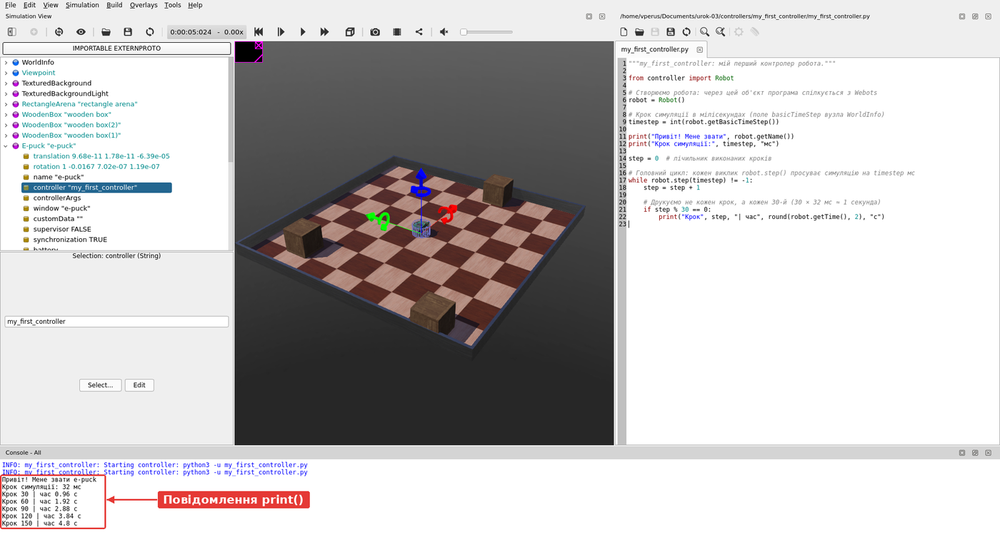

У консолі з'явилися повідомлення від вашої програми:

```
Привіт! Мене звати e-puck
Крок симуляції: 32 мс
Крок 30 | час 0.96 с
Крок 60 | час 1.92 с
Крок 90 | час 2.88 с
```

Новий рядок з'являється приблизно щосекунди: 30 кроків × 32 мс = 960 мс = 0,96 с.

!!! info "Час симуляції і реальний час"

    `robot.getTime()` повертає **час симуляції**, а не час на годиннику. Натисніть **Fast** (⏩): рядки посиплються набагато швидше, але значення часу в них залишаться такими самими.

!!! warning "Після кожної зміни коду"

    **Ctrl+S** (зберегти файл) → **Reset Simulation** → **Real-time**. Під час скидання Webots перезапускає контролер, тож нова версія програми почне роботу спочатку.

    **Ctrl+S** зберігає файл у текстовому редакторі, а **Ctrl+Shift+S** зберігає світ.

## Крок 5. Зупиняємо програму через 5 секунд

Цикл `while` можна завершити й самостійно, командою `break`. Допишіть у кінець **тіла циклу** (з відступом 4 пробіли, як у рядка `if step % 30 == 0:`) перевірку часу, а **після циклу** (без відступу) — ще одне повідомлення:

```python
    # Через 5 секунд симуляції виходимо з циклу
    if robot.getTime() >= 5:
        print("Минуло 5 секунд. Завершую роботу.")
        break

print("Контролер завершено.")
```

Повний код наведено [нижче](#povnyi-kod). Збережіть файл (**Ctrl+S**), натисніть **Reset Simulation** і **Real-time**.

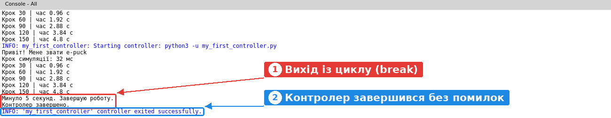

1. Через 5 секунд програма вийшла з циклу й надрукувала два останні повідомлення.
2. Webots повідомляє: `'my_first_controller' controller exited successfully`, тобто контролер завершився без помилок.

Зверніть увагу: лічильник часу йде далі. Симуляція продовжується і без контролера, просто роботом більше ніхто не керує.

## Повний код контролера {#povnyi-kod}

```python
"""my_first_controller: мій перший контролер робота."""

from controller import Robot

# Створюємо робота: через цей об'єкт програма спілкується з Webots
robot = Robot()

# Крок симуляції в мілісекундах (поле basicTimeStep вузла WorldInfo)
timestep = int(robot.getBasicTimeStep())

print("Привіт! Мене звати", robot.getName())
print("Крок симуляції:", timestep, "мс")

step = 0  # лічильник виконаних кроків

# Головний цикл: кожен виклик robot.step() просуває симуляцію на timestep мс
while robot.step(timestep) != -1:
    step = step + 1

    # Друкуємо не кожен крок, а кожен 30-й (30 × 32 мс ≈ 1 секунда)
    if step % 30 == 0:
        print("Крок", step, "| час", round(robot.getTime(), 2), "с")

    # Через 5 секунд симуляції виходимо з циклу
    if robot.getTime() >= 5:
        print("Минуло 5 секунд. Завершую роботу.")
        break

print("Контролер завершено.")
```

## Перевірте себе

**1. Що робить команда `robot.step(timestep)`?**

??? success "Відповідь"

    Просуває симуляцію на один крок (`timestep` мілісекунд) і повертає керування програмі. Коли Webots зупиняє контролер (скидання симуляції, закриття світу), вона повертає `-1`.

**2. Чому робот стоїть на місці, хоча програма працює?**

??? success "Відповідь"

    Програма нічого не наказує двигунам: вона лише рахує кроки й друкує повідомлення. Як керувати двигунами, ви дізнаєтеся в наступному уроці.

**3. Як часто друкувалися б рядки, якби `basicTimeStep` дорівнював 16 мс?**

??? success "Відповідь"

    Кожні 30 × 16 мс = 480 мс, тобто приблизно двічі на секунду. У рядку «Крок симуляції» було б `16 мс`.

**4. Ви змінили код і запустили симуляцію, але в консолі старі повідомлення. Що ви забули?**

??? success "Відповідь"

    Зберегти файл (**Ctrl+S**) або натиснути **Reset Simulation**, щоб контролер перезапустився з новим кодом.

**5. Що станеться, якщо в циклі `while` не викликати `robot.step()` (наприклад, написати `while True: pass`)?**

??? success "Відповідь"

    Програма крутитиметься в циклі, жодного разу не віддавши керування Webots. Симуляція чекає на контролер, тому час зупиниться.

## Чек-лист

- [ ] Створено контролер `my_first_controller` мовою Python
- [ ] Поле `controller` робота e-puck дорівнює `my_first_controller`, світ збережено
- [ ] У консолі є повідомлення «Привіт! Мене звати e-puck» і рядки з кроками
- [ ] Через 5 секунд програма завершується з повідомленням `exited successfully`
- [ ] Я знаю, навіщо в головному циклі потрібен `robot.step(timestep)`

## Якщо щось пішло не так

Якщо в програмі є помилка, Python друкує в консолі червоний текст **Traceback**. Ось що буде, якщо написати `prnt` замість `print`:

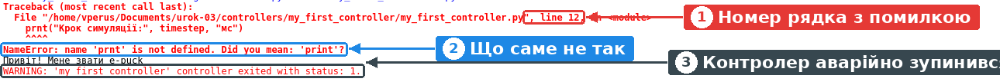

1. Номер рядка, у якому сталася помилка.
2. Що саме не так: `name 'prnt' is not defined. Did you mean: 'print'?`, тобто «назва `prnt` не визначена; можливо, ви мали на увазі `print`?».
3. Контролер аварійно завершився (`exited with status: 1`).

Виправте рядок, збережіть файл (**Ctrl+S**) і натисніть **Reset Simulation**.

| Проблема | Що робити |
| --- | --- |
| У списку **Select...** немає `my_first_controller` | Контролер створено в іншому проєкті. Він має лежати в папці `controllers` того самого проєкту, що й світ. Перевірте шлях на сторінці **Conclusion** майстра |
| Робот і далі їздить і об'їжджає коробки | У полі `controller` лишилося `e-puck_avoid_obstacles`. Повторіть крок 2 і збережіть світ |
| `IndentationError` у консолі | Неправильні відступи. Тіло циклу й умови — 4 пробіли, вкладене в умову всередині циклу — 8 |
| `SyntaxError` у консолі | Пропущено двокрапку після `while ...` чи `if ...` або лапку чи дужку. Подивіться на рядок, указаний у повідомленні |
| Вивід не змінився після редагування | Збережіть файл (**Ctrl+S**) і натисніть **Reset Simulation** |
| Контролер не запускається, у консолі є слово `python3` | Встановіть Python: `sudo apt install python3`. Перевірте, що в **Tools → Preferences → General → Python command** вказано `python3` |

## Додаткове завдання

1. Друкуйте рядок не кожен 30-й, а кожен 10-й крок. Як часто тепер з'являються повідомлення?
2. Змініть поле `basicTimeStep` вузла `WorldInfo` на `16` (не забудьте **Pause → Reset → змінити → Save**). Що змінилося у виводі програми? Поверніть значення `32`.
3. Зробіть зворотний відлік: щосекунди друкуйте, скільки секунд лишилося до зупинки (`До зупинки: 4 с`, `До зупинки: 3 с`...).
