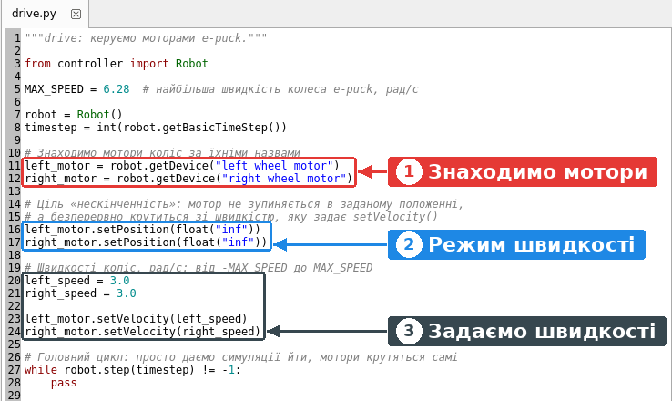
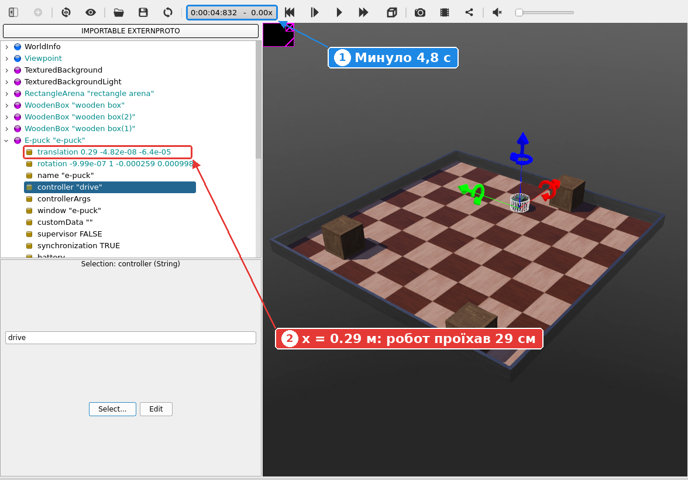
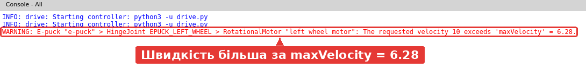
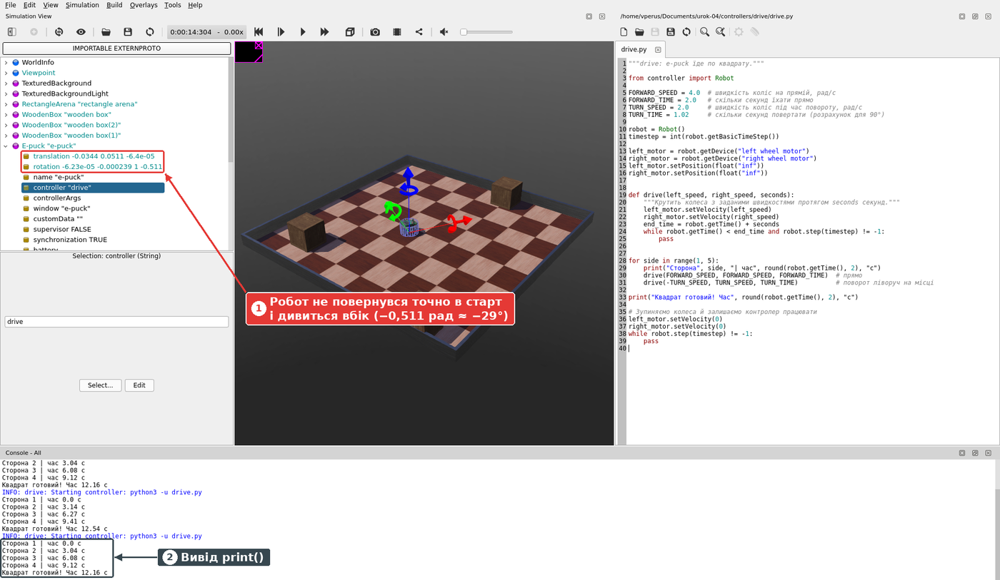

# Урок 4. Мотори: їдемо прямо, повертаємо, малюємо квадрат

**Мета:** навчитися керувати колесами e-puck з програми: їхати прямо, повертати й проїхати заданий маршрут — квадрат.

**Час:** 35 хвилин.

## Що знадобиться

* **Webots R2025a**.
* **Проєкт після уроку 3**: світ `my_first_simulation` з контролером `my_first_controller`. Якщо його немає, завантажте стартовий проєкт [urok-04.zip](../downloads/urok-04.zip), розпакуйте в домашню папку й відкрийте `urok-04/worlds/my_first_simulation.wbt`.
* Уміння створити контролер і призначити його роботу ([урок 3](urok-03-pershyi-kontroler.md)).

## Коротко: як їздить e-puck

У e-puck два колеса, і кожне має власний двигун. Керма немає: робот повертає, коли колеса крутяться з **різною швидкістю**. Так само повертають танк чи інвалідний візок. Така схема називається **диференціальним приводом** (differential drive).

| Ліве колесо | Праве колесо | Що робить робот |
| --- | --- | --- |
| `3` | `3` | Їде прямо вперед |
| `-3` | `-3` | Їде прямо назад |
| `2` | `4` | Їде по дузі ліворуч (праве колесо швидше) |
| `4` | `2` | Їде по дузі праворуч |
| `-2` | `2` | Повертає ліворуч на місці |
| `2` | `-2` | Повертає праворуч на місці |

**Швидкість колеса** задають у **радіанах за секунду** (рад/с). Один повний оберт — це 2π ≈ 6,28 радіана. Найбільша швидкість колеса e-puck — **6,28 рад/с**, тобто один оберт за секунду.

Щоб дізнатися, як швидко їде сам робот, швидкість колеса множать на його радіус (у e-puck це 2 см = 0,02 м):

> швидкість робота = швидкість колеса × радіус колеса

Наприклад, 3 рад/с × 0,02 м = **0,06 м/с**, тобто 6 см за секунду. Найбільша швидкість e-puck: 6,28 × 0,02 ≈ 0,126 м/с, приблизно 12,5 см/с.

**Як програма керує двигуном.** Двигун колеса в Webots — це пристрій `RotationalMotor`. Програма знаходить його за назвою, а далі дає дві команди:

| Команда | Що робить |
| --- | --- |
| `robot.getDevice("left wheel motor")` | Знаходить пристрій (тут — двигун лівого колеса) за його назвою |
| `motor.setPosition(float("inf"))` | Вмикає **режим швидкості**: двигун не повертається до заданого кута, а крутиться безперервно |
| `motor.setVelocity(3.0)` | Задає швидкість обертання, рад/с |

!!! info "Навіщо вмикати режим швидкості?"

    Без цієї команди двигун працює в **режимі положення**: він повертає колесо до заданого кута й зупиняється. Початкова ціль — кут 0, тож колесо стоїть. Коли ціль — «нескінченність» (`inf`), двигун ніколи її не досягне й просто крутиться зі швидкістю, заданою в `setVelocity()`.

## Крок 1. Створюємо контролер drive

1. Відкрийте свій світ. Натисніть **Pause** і **Reset Simulation**.
2. Створіть новий контролер, як в уроці 3: **File → New → New Robot Controller...**, мова **Python**, назва **`drive`**.
3. Призначте його роботу: `E-puck` → поле `controller` → **Select...** → **`drive`** → **OK**.
4. Збережіть світ (**Ctrl+Shift+S**).

## Крок 2. Їдемо прямо

1. Замініть код у файлі `drive.py` на цей:

    ```python
    """drive: керуємо моторами e-puck."""

    from controller import Robot

    MAX_SPEED = 6.28  # найбільша швидкість колеса e-puck, рад/с

    robot = Robot()
    timestep = int(robot.getBasicTimeStep())

    # Знаходимо мотори коліс за їхніми назвами
    left_motor = robot.getDevice("left wheel motor")
    right_motor = robot.getDevice("right wheel motor")

    # Ціль «нескінченність»: мотор не зупиняється в заданому положенні,
    # а безперервно крутиться зі швидкістю, яку задає setVelocity()
    left_motor.setPosition(float("inf"))
    right_motor.setPosition(float("inf"))

    # Швидкості коліс, рад/с: від -MAX_SPEED до MAX_SPEED
    left_speed = 3.0
    right_speed = 3.0

    left_motor.setVelocity(left_speed)
    right_motor.setVelocity(right_speed)

    # Головний цикл: просто даємо симуляції йти, мотори крутяться самі
    while robot.step(timestep) != -1:
        pass
    ```

    

    1. Знаходимо двигуни лівого й правого коліс.
    2. Вмикаємо режим швидкості.
    3. Задаємо швидкості коліс.

2. Збережіть файл (**Ctrl+S**), натисніть **Reset Simulation** і **Real-time**.

Робот поїхав прямо вперед, у напрямку червоної стрілки (вісь **x**). Через кілька секунд натисніть **Pause** і розгорніть вузол `E-puck` у дереві сцени.



1. Минуло 4,8 секунди симуляції.
2. Перше число в полі `translation` (координата **x**) дорівнює `0.29`: робот проїхав 29 см.

Перевіримо розрахунком: 0,06 м/с × 4,8 с ≈ 0,29 м. Збігається!

Якщо симуляцію не зупиняти, робот доїде до стінки й буде впиратися в неї: програма не користується датчиками й не «бачить» перешкод. Датчики відстані — тема наступного уроку.

## Крок 3. Експериментуємо зі швидкостями

Змінюйте лише два числа, `left_speed` і `right_speed`. Після кожної зміни: **Ctrl+S** → **Reset Simulation** → **Real-time**. Запишіть, що робить робот:

| `left_speed` | `right_speed` | Що робить робот? |
| --- | --- | --- |
| `-3.0` | `-3.0` | |
| `2.0` | `4.0` | |
| `4.0` | `2.0` | |
| `-2.0` | `2.0` | |
| `0.0` | `3.0` | |
| `10.0` | `10.0` | |

??? success "Відповідь"

    * `-3`, `-3`: їде назад.
    * `2`, `4`: їде по колу ліворуч (проти годинникової стрілки, якщо дивитися згори).
    * `4`, `2`: їде по колу праворуч.
    * `-2`, `2`: крутиться на місці ліворуч.
    * `0`, `3`: повертає навколо лівого колеса, яке стоїть.
    * `10`, `10`: їде прямо з найбільшою швидкістю, а в консолі з'являється попередження (дивіться нижче).

Швидкість 10 рад/с більша за можливу. Webots обмежує її до 6,28 рад/с і попереджає про це червоним рядком у консолі:



Щоб не помилитися, задавайте швидкість як частку від найбільшої: `left_speed = 0.5 * MAX_SPEED`.

## Крок 4. Їдемо по квадрату

Квадрат — це чотири однакові частини: **проїхати прямо → повернути на 90°**. Робот не знає, де він і куди повернутий, тому кожну дію задамо **за часом**: «крути колеса так-то протягом стількох-то секунд».

**Скільки їхати прямо.** Колеса крутяться зі швидкістю 4 рад/с, отже робот їде 4 × 0,02 = 0,08 м/с. За 2 секунди він проїде 16 см: це сторона квадрата.

**Скільки повертати.** Колеса e-puck розташовані на відстані 5,2 см одне від одного. Під час повороту на місці кожне колесо котиться по колу радіусом 2,6 см навколо центра робота. Поворот на 90° — це чверть кола: 2 × 3,14 × 2,6 см / 4 ≈ 4,1 см. Колесо зі швидкістю 2 рад/с котиться 2 × 0,02 = 0,04 м/с, тобто 4 см/с. Отже, поворот триває приблизно 4,1 / 4 ≈ **1,02 с**.

Замініть код на новий. Тепер у програмі є **функція** `drive()`: вона задає швидкості коліс і виконує кроки симуляції, доки не мине потрібний час. Числа, які доведеться підбирати, винесено у **сталі** на початку програми.

```python
"""drive: e-puck їде по квадрату."""

from controller import Robot

FORWARD_SPEED = 4.0  # швидкість коліс на прямій, рад/с
FORWARD_TIME = 2.0   # скільки секунд їхати прямо
TURN_SPEED = 2.0     # швидкість коліс під час повороту, рад/с
TURN_TIME = 1.02     # скільки секунд повертати (розрахунок для 90°)

robot = Robot()
timestep = int(robot.getBasicTimeStep())

left_motor = robot.getDevice("left wheel motor")
right_motor = robot.getDevice("right wheel motor")
left_motor.setPosition(float("inf"))
right_motor.setPosition(float("inf"))


def drive(left_speed, right_speed, seconds):
    """Крутить колеса з заданими швидкостями протягом seconds секунд."""
    left_motor.setVelocity(left_speed)
    right_motor.setVelocity(right_speed)
    end_time = robot.getTime() + seconds
    while robot.getTime() < end_time and robot.step(timestep) != -1:
        pass


for side in range(1, 5):
    print("Сторона", side, "| час", round(robot.getTime(), 2), "с")
    drive(FORWARD_SPEED, FORWARD_SPEED, FORWARD_TIME)  # прямо
    drive(-TURN_SPEED, TURN_SPEED, TURN_TIME)          # поворот ліворуч на місці

print("Квадрат готовий! Час", round(robot.getTime(), 2), "с")

# Зупиняємо колеса й залишаємо контролер працювати
left_motor.setVelocity(0)
right_motor.setVelocity(0)
while robot.step(timestep) != -1:
    pass
```

Збережіть файл, натисніть **Reset Simulation** і **Real-time**. Робот проїде чотири сторони й зупиниться приблизно через 12 секунд.



1. Робот повернувся **не точно** в точку старту й дивиться вбік. Останнє число поля `rotation` — кут повороту робота в радіанах: −0,511 рад ≈ −29°. Отже, кожен поворот вийшов коротшим за 90° приблизно на 7°.
2. У консолі видно початок кожної сторони і повідомлення про завершення.

**Чому розрахунок не справдився?** Ми рахували так, ніби колеса миттєво набирають швидкість і зовсім не проковзують. Насправді (і в симуляції, і в реальному світі) робот розганяється й гальмує, а колеса трохи ковзають по підлозі. До того ж робот не перевіряє, що вийшло: він просто крутить колеса потрібний час. Таке керування називають **керуванням без зворотного зв'язку** (open-loop control). Як точно вимірювати поворот коліс, ви дізнаєтеся в уроці про енкодери й одометрію.

**Завдання.** Підберіть значення `TURN_TIME` так, щоб квадрат замкнувся: робот має повернутися в точку старту й дивитися в той самий бік, що й на початку. Спробуйте 1.05, 1.1, 1.15. Щоб не чекати, запускайте симуляцію кнопкою **Fast** (⏩).

??? success "Відповідь"

    Приблизно **1.1 с**. Тоді після квадрата робот опиняється в межах кількох міліметрів від старту, а помилка кута становить близько 1°.

## Перевірте себе

**1. Навіщо перед `setVelocity()` викликати `setPosition(float("inf"))`?**

??? success "Відповідь"

    Щоб увімкнути режим швидкості. Інакше двигун працює в режимі положення, тримає колесо під кутом 0, і робот стоїть.

**2. Які швидкості задати, щоб робот повертав праворуч на місці?**

??? success "Відповідь"

    Ліве колесо вперед, праве назад з тією самою швидкістю, наприклад `left_speed = 2.0`, `right_speed = -2.0`.

**3. Колеса крутяться зі швидкістю 5 рад/с. Яку відстань проїде e-puck за 5 секунд?**

??? success "Відповідь"

    5 рад/с × 0,02 м = 0,1 м/с; 0,1 м/с × 5 с = 0,5 м.

**4. Чому квадрат, порахований «на папері», не замкнувся?**

??? success "Відповідь"

    Розрахунок не враховує розгону, гальмування й проковзування коліс, а робот не перевіряє результат (керування без зворотного зв'язку). Маленька помилка кожного повороту накопичується.

## Чек-лист

- [ ] Створено контролер `drive` і призначено його роботу
- [ ] Робот їде прямо; я можу перевірити пройдену відстань у полі `translation`
- [ ] Я знаю, які швидкості коліс дають рух назад, по дузі й поворот на місці
- [ ] Робот проїжджає квадрат
- [ ] Я підібрав `TURN_TIME`, за якого квадрат замикається

## Якщо щось пішло не так

| Проблема | Що робити |
| --- | --- |
| Робот не рухається, помилок немає | Перевірте, що є рядки `setPosition(float("inf"))` для обох двигунів |
| `Device "..." was not found on robot "e-puck"` і далі `AttributeError: 'NoneType' object has no attribute 'setPosition'` | Назву двигуна написано з помилкою. Правильно: `"left wheel motor"` і `"right wheel motor"`, з пробілами |
| Попередження `The requested velocity ... exceeds 'maxVelocity' = 6.28` | Швидкість більша за 6,28 рад/с. Зменште її або використовуйте `MAX_SPEED` |
| Робот повертає не в той бік | Поміняйте знаки швидкостей коліс |
| Робот упирається в стінку чи коробку | Натисніть **Reset Simulation**. Для квадрата навколо робота має бути вільно щонайменше 20 см |
| Вивід не змінився після редагування | Збережіть файл (**Ctrl+S**) і натисніть **Reset Simulation** |

## Додаткове завдання

1. **Коло.** Задайте `left_speed = 2.0`, `right_speed = 4.0` у програмі з кроку 2. Оцініть за полем `translation`, який діаметр кола. (Розрахунок дає приблизно 16 см.)
2. **Трикутник.** Змініть програму-квадрат так, щоб робот проїхав рівносторонній трикутник: три сторони й повороти на 120°. Як змінити `TURN_TIME`?
3. **Вісімка.** Складіть маршрут із двох кіл: одне ліворуч, друге праворуч.
